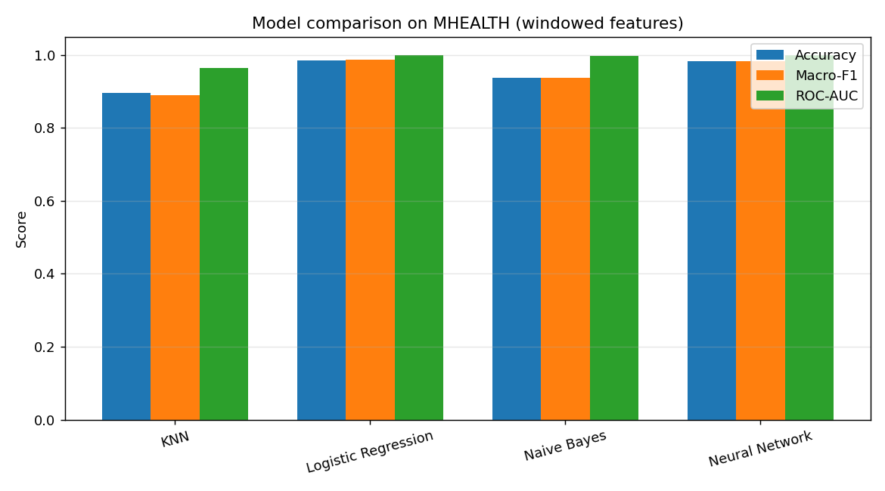
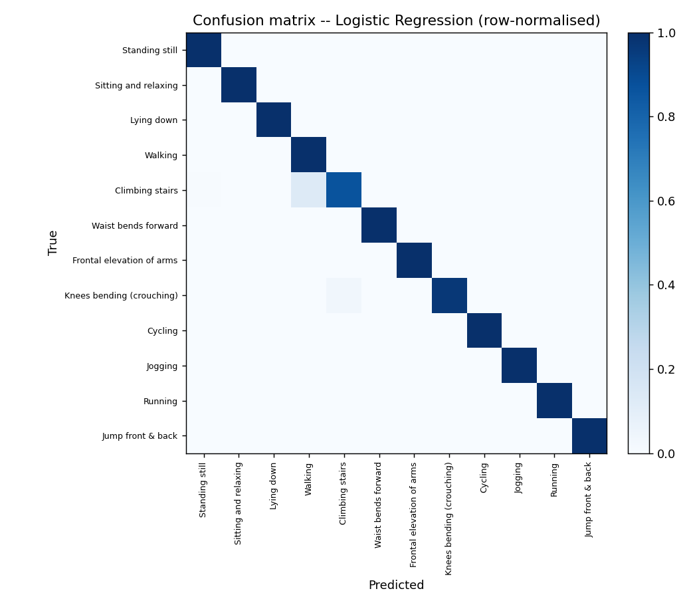
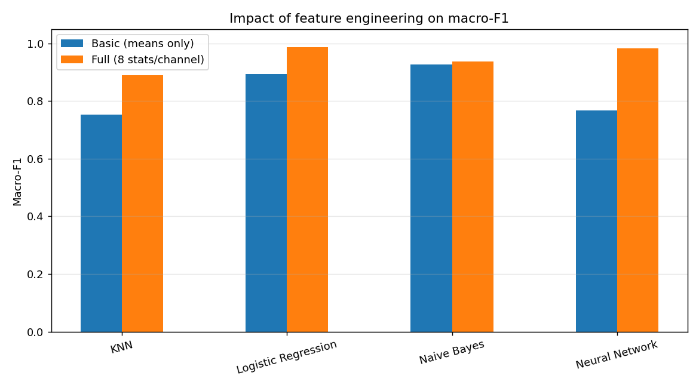

# Multi-Model Benchmarking on Time-Series Sensor Data (MHEALTH)


Four classic classifiers — **k-Nearest Neighbours, Logistic Regression, Gaussian
Naive Bayes, and a feed-forward Neural Network** — implemented **from scratch in
pure NumPy/Pandas** and benchmarked head-to-head on the
[UCI **MHEALTH**](https://archive.ics.uci.edu/dataset/319/mhealth+dataset)
wearable-sensor dataset.

The task — labelling short windows of 23-channel, 50 Hz body-sensor signals with
one of 12 physical activities — is a **time-structured, multivariate
classification problem**, structurally analogous to energy load forecasting and
demand prediction: multiple correlated sensor streams sampled over time, summarised
into windowed features, then mapped to a target. The goal here is not a single
"best" model but a controlled comparison of algorithm families and, crucially, of
the **feature-engineering choices** that move the needle most.

---

## Highlights

- **Everything from first principles.** Softmax/cross-entropy gradient descent
  (Logistic Regression + NN backprop), Gaussian probabilistic inference (Naive
  Bayes), and vectorised distance metrics (KNN) — no scikit-learn. Even the
  metrics (accuracy, macro-F1, one-vs-rest ROC-AUC via the rank statistic) are
  hand-implemented.
- **Honest evaluation.** A **leave-subjects-out** protocol (train and test on
  *different people*) is the default. A naive random split leaks near-identical,
  overlapping windows across the partition and inflates every score toward 100%
  — the code exposes both so the gap is visible.
- **Feature engineering as a first-class experiment.** A dedicated study
  quantifies how an 8-statistic-per-channel representation beats a mean-only
  baseline, isolating the single biggest source of accuracy gains.

---

## Results

Evaluated on held-out **subjects 8, 9, 10** (never seen in training), using
128-sample windows (2.56 s) with 50% overlap and 8 statistics per sensor channel
(184 features). Seed = 42.

| Model | Accuracy | Macro-F1 | ROC-AUC (OvR) | Fit time |
|---|---|---|---|---|
| **Logistic Regression** | **0.985** | **0.986** | 1.000 | 1.5 s |
| Neural Network | 0.982 | 0.983 | 1.000 | 1.5 s |
| Naive Bayes | 0.936 | 0.937 | 0.997 | <0.1 s |
| KNN (k=7, distance-weighted) | 0.896 | 0.890 | 0.964 | <0.1 s |

<p align="center">
  
</p>

The best model's confusion matrix is near-diagonal; essentially the only residual
error is **Climbing stairs** occasionally read as **Walking** — an intuitive
confusion between two locomotion activities.

<p align="center">
  
</p>

### Feature engineering drove the largest gains

Swapping the mean-only representation (23 features) for the full 8-statistic set
(184 features) is the highest-impact change in the whole pipeline — worth **+22
F1 points for the Neural Network and +14 for KNN**. Models that rely on raw
feature geometry (distance- and gradient-based) benefit most; Naive Bayes, which
already models per-feature spread, gains the least.

| Model | Basic (means only) | Full (8 stats/channel) | Δ Macro-F1 |
|---|---|---|---|
| Neural Network | 0.767 | 0.983 | **+0.216** |
| KNN | 0.752 | 0.890 | **+0.138** |
| Logistic Regression | 0.893 | 0.986 | +0.093 |
| Naive Bayes | 0.926 | 0.937 | +0.011 |

<p align="center">
  
</p>

> Numbers are reproducible with `python scripts/run_benchmark.py` (seed 42).

---

## Methodology

1. **Load** all 10 subjects' raw `.log` files (~1.2 M samples, 23 sensor channels
   + label at 50 Hz).
2. **Window** each subject's stream into 128-sample windows with 50% overlap.
   Only *pure* windows (a single activity from start to end) are kept, and the
   null class is dropped.
3. **Engineer features** — for every window and every channel, compute 8 summary
   statistics (mean, std, min, max, median, range, RMS energy, mean absolute
   deviation), giving a 184-dimensional feature vector per window.
4. **Split** by subject (leave-subjects-out) so evaluation measures
   generalisation to *new people*, not memorisation of overlapping windows.
5. **Standardise** features using statistics fit on the training split only.
6. **Train & evaluate** the four from-scratch models on accuracy, macro-F1 and
   one-vs-rest ROC-AUC; export a metrics table and plots.

### The models (all `src/models/`)

| Model | Core idea implemented from scratch |
|---|---|
| `KNNClassifier` | Vectorised pairwise distances via the `‖a−b‖² = ‖a‖²+‖b‖²−2a·b` identity; distance-weighted voting. |
| `LogisticRegression` | Multinomial softmax regression; full-batch gradient descent on the cross-entropy loss with the clean `Xᵀ(P−Y)` gradient and L2 regularisation. |
| `GaussianNaiveBayes` | Per-class Gaussian likelihoods with conditional-independence assumption; all maths done in log-space for stability. |
| `NeuralNetwork` | Configurable ReLU MLP with softmax output, He initialisation, and mini-batch SGD backprop through cached activations. |

---

## Project structure

```
Multi-Model-Benchmarking-MHEALTH/
├── src/
│   ├── data_loader.py        # load logs + sliding-window feature engineering
│   ├── preprocessing.py      # train/test split, StandardScaler, one-hot
│   ├── metrics.py            # accuracy, precision/recall/F1, ROC-AUC (from scratch)
│   └── models/
│       ├── base.py           # shared fit / predict / predict_proba interface
│       ├── knn.py
│       ├── logistic_regression.py
│       ├── naive_bayes.py
│       └── neural_network.py
├── scripts/
│   ├── download_data.py      # fetch + extract the dataset from UCI
│   └── run_benchmark.py      # end-to-end benchmark (CLI)
├── tests/
│   └── test_models.py        # sanity tests for models + metrics
├── results/                  # generated tables and plots
├── data/                     # dataset lives here (git-ignored, see data/README.md)
├── requirements.txt
└── LICENSE
```

---

## Quickstart

```bash
# 1. Install dependencies (numpy, pandas, matplotlib)
pip install -r requirements.txt

# 2. Download the MHEALTH dataset (~75 MB) into data/raw/
python scripts/download_data.py

# 3. Run the full benchmark (subject-independent split by default)
python scripts/run_benchmark.py
```

Useful flags:

```bash
# Reproduce the leakage effect of a naive random split
python scripts/run_benchmark.py --split random

# Faster iteration on a subset of subjects / capped windows per class
python scripts/run_benchmark.py --subjects 1 2 3 4 5 --max-per-class 300

# Choose your own held-out subjects, skip plots
python scripts/run_benchmark.py --test-subjects 1 5 10 --no-plots
```

Run the tests:

```bash
python tests/test_models.py      # or: pytest -q
```

---

## Notes & limitations

- **Window overlap + random splitting leaks information.** This repo defaults to
  the honest subject-independent protocol; `--split random` is provided only to
  demonstrate *why* the naive numbers look "too good."
- Reported scores are for one fixed held-out set of subjects. For a paper-grade
  estimate you would wrap the benchmark in full leave-one-subject-out
  cross-validation and average across folds.
- The 2-lead ECG channels are included as generic signals; the original authors
  collected them for future work rather than activity recognition.

## Dataset & citation

> Banos, O., Garcia, R., Holgado-Terriza, J.A., Damas, M., Pomares, H., Rojas, I.,
> Saez, A., Villalonga, C. **mHealthDroid: a novel framework for agile development
> of mobile health applications.** IWAAL 2014.
> — UCI Machine Learning Repository, *MHEALTH Dataset*.

## License

Released under the [MIT License](LICENSE).
